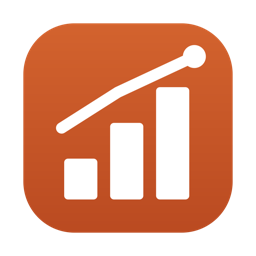
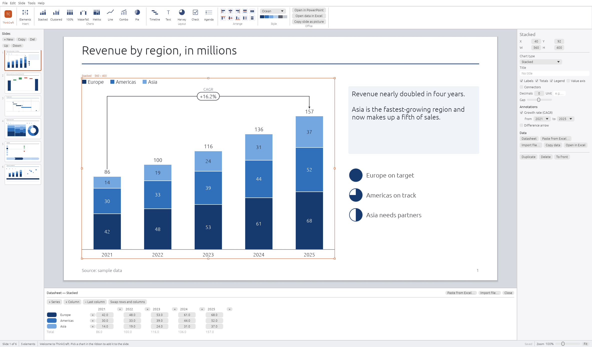
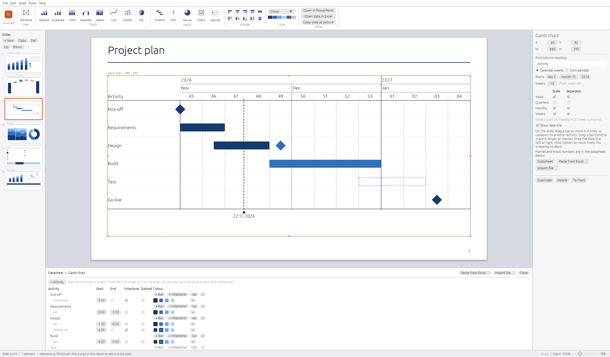
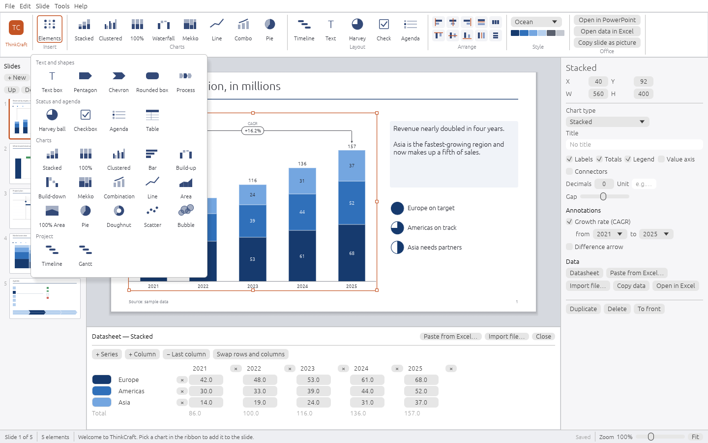

<p align="center">
  
</p>

<h1 align="center">ThinkCraft</h1>

<p align="center">
  <b>Business charts and slide layouts, in a native desktop app written in Rust.</b><br>
  Stacked, waterfall, Mekko and Gantt charts, Harvey balls, agendas and process flows,<br>
  exported as editable PowerPoint slides and Excel data. Open source, offline, and yours.
</p>

<p align="center">
  
  
  
  
  
</p>

<p align="center">
  <a href="#features">Features</a> ·
  <a href="#everything-in-the-box">Everything in the box</a> ·
  <a href="#works-with-office">Office</a> ·
  <a href="#scriptable">Scriptable</a> ·
  <a href="#under-the-hood">Under the hood</a> ·
  <a href="#get-started">Get started</a>
</p>

<br>

<p align="center">
  
  <br>
  <sub>A stacked chart with a CAGR annotation, a text box and Harvey balls, with the datasheet open below.</sub>
</p>

> [!WARNING]
> **ThinkCraft is in early alpha.** It works, but expect rough edges, missing features and changes to the `.tcraft` file format between versions. Keep copies of decks you care about, and please [report problems](https://github.com/Simsen/ThinkCraft/issues) you run into.

<br>

<table>
  <tr>
    <td width="25%" valign="top">
      <h3>📊 Charts that tell the story</h3>
      Sixteen chart types, from stacked and clustered columns to waterfalls, Mekkos and bubbles, with totals, labels and growth annotations built in.
    </td>
    <td width="25%" valign="top">
      <h3>🗓️ Plans on a real calendar</h3>
      Gantt charts on ISO calendar weeks, with months and years above, milestones, dashed bars and a today line. Drag bars to reschedule.
    </td>
    <td width="25%" valign="top">
      <h3>📎 Office in, Office out</h3>
      Paste data from Excel, import .xlsx or .csv, and export every slide as an editable PowerPoint file and the data as an Excel workbook.
    </td>
    <td width="25%" valign="top">
      <h3>⚡ Native and offline</h3>
      A single Rust binary on egui. No Electron, no web view, no account and no cloud.
    </td>
  </tr>
</table>

<br>

## Features

<table>
  <tr>
    <td width="50%" valign="top">
      
      <br>
      <sub>A project plan across calendar weeks 45–04, with milestones and a date line.</sub>
      <h3>Timelines that fit the slide</h3>
      Pick calendar weeks or your own periods, choose which scales (years, quarters, months, weeks) and separators to show, and set the start date and length. Each activity can hold several bars and milestones.
      <br><br>
      Drag a bar to move it in time or to another activity, drag its end to change its length, and drag the date line to where you are. Exact numbers live in the datasheet.
    </td>
    <td width="50%" valign="top">
      
      <br>
      <sub>The Elements gallery: shapes, status elements, charts and project views.</sub>
      <h3>Every building block of a business slide</h3>
      Text boxes, pentagons, chevrons, rounded boxes and process flows; Harvey balls, checkboxes, agendas and tables; and every chart, one click from the ribbon.
      <br><br>
      Align edges and centres, match widths and heights, and switch the whole deck between colour styles at once.
    </td>
  </tr>
</table>

<br>

## Everything in the box

<table>
  <tr>
    <td width="33%" valign="top">
      <h4>📈 16 chart types</h4>
      Stacked · 100% · Clustered · Bar · Build-up · Build-down · Waterfall · Mekko · Combination · Line · Area · 100% Area · Pie · Doughnut · Scatter · Bubble
      <br><br>
      Labels, totals, legends, value axes, connectors, decimals and units, and a decimal-comma option.
    </td>
    <td width="33%" valign="top">
      <h4>🧭 Annotations</h4>
      Growth rate (CAGR) arrows between any two categories and difference arrows, drawn on the chart and kept in step with the data.
    </td>
    <td width="33%" valign="top">
      <h4>🧱 Layout elements</h4>
      Text box · Pentagon · Chevron · Rounded box · Process flow · Harvey ball · Checkbox · Agenda · Table · Timeline · Gantt
    </td>
  </tr>
  <tr>
    <td width="33%" valign="top">
      <h4>🧮 A datasheet for every chart</h4>
      Add series and columns, swap rows and columns, see totals as you type, and paste straight from Excel.
    </td>
    <td width="33%" valign="top">
      <h4>🗂️ Decks and slides</h4>
      Slide titles, footnotes and page numbers; new, duplicate, delete and reorder slides; undo; and autosave of the open deck.
    </td>
    <td width="33%" valign="top">
      <h4>🪄 Arrange</h4>
      Align left, centre, right, top, middle and bottom; same width and height; bring to front and send to back; exact position and size in the properties panel.
    </td>
  </tr>
</table>

<br>

## Works with Office

- **Open in PowerPoint:** builds a `.pptx` of every slide from native shapes and text, so everything stays editable, and opens it.
- **Open data in Excel:** writes the data of the selected chart, or of every chart, to a `.xlsx` workbook and opens it.
- **Copy slide as picture:** puts the slide on the clipboard to paste anywhere.
- **Import:** paste a table from Excel, or import the first sheet of an `.xlsx` workbook or a `.csv`, `.tsv` or `.txt` file.

## Scriptable

The same engine runs without the window, which is how the screenshots in this README were made:

```sh
thinkcraft deck.tcraft --export-pptx deck.pptx      # build a PowerPoint file
thinkcraft deck.tcraft --export-xlsx data.xlsx      # export the chart data
thinkcraft deck.tcraft --screenshot slide.png       # render the window to a PNG
```

## Under the hood

- **Pure Rust:** egui/eframe for the UI, `zip` for the Office files and `calamine` for reading workbooks.
- **One document model:** a deck is plain data (slides of positioned elements), saved as JSON in `.tcraft` files.
- **One renderer, two outputs:** the same drawing code paints the canvas and produces the PowerPoint shapes.
- **Clean-room:** written from scratch and from the public Office Open XML format. No proprietary code or assets.

## Get started

**Just want to use it?** Download the Windows or macOS build from the [latest release](https://github.com/Simsen/ThinkCraft/releases).

To build it yourself you need a Rust toolchain ([rustup](https://rustup.rs)); on Windows, let rustup install the Visual Studio C++ build tools.

```sh
git clone https://github.com/Simsen/ThinkCraft
cd ThinkCraft
cargo run --release      # the desktop app
cargo test               # the tests
sh make-mac-app.sh       # macOS: build dist/ThinkCraft.app
                         # Windows: the app is target\release\thinkcraft.exe
```

See [HOW-TO-START.md](HOW-TO-START.md) for installing on Windows and macOS, keyboard shortcuts and where your work is kept.

> [!IMPORTANT]
> **Status:** ThinkCraft is in early alpha. It runs on Windows and macOS; every change is built and tested on both by [GitHub Actions](https://github.com/Simsen/ThinkCraft/actions). Linux may build but is untested. File formats may still change between versions.

## License

Licensed under either of

- Apache License, Version 2.0 ([LICENSE-APACHE](LICENSE-APACHE))
- MIT license ([LICENSE-MIT](LICENSE-MIT))

at your option.

Unless you explicitly state otherwise, any contribution intentionally submitted for inclusion in the work by you, as defined in the Apache-2.0 license, shall be dual licensed as above, without any additional terms or conditions.
